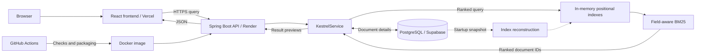
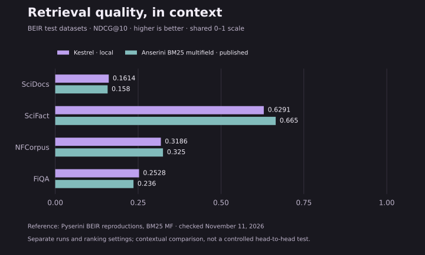
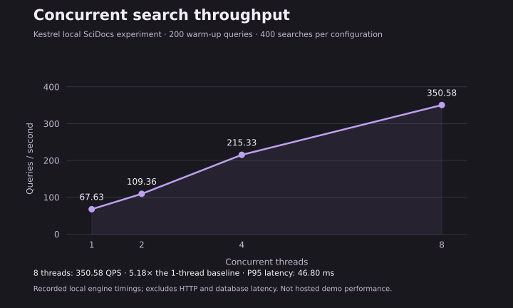

# Kestrel

### Search, built from first principles.

A custom Java search engine with field-aware BM25 ranking, positional inverted indexes, concurrent queries, and PostgreSQL persistence. A React interface makes the engine searchable and its architecture explorable.

[](https://www.oracle.com/java/)
[](pom.xml)
[](client/package.json)
[](compose.yaml)
[](https://github.com/Cs7797/Kestrel_searchEngine/actions)

**[Try the read-only demo](https://kestrel-search-engine.vercel.app/)** · [Source code](https://github.com/Cs7797/Kestrel_searchEngine) · [Frontend setup](client/README.md)

## Live demo

**[kestrel-search-engine.vercel.app](https://kestrel-search-engine.vercel.app/)** searches a curated demonstration dataset of **70 technical documents**. Results come from Kestrel's Java engine, with no mock search responses or external search services.

Try `java concurrency`, `BM25 ranking`, `docker compose`, `postgresql transactions`, or `machine learning`.

The public demonstration is **read-only**: document creation, editing, and deletion are disabled to protect the dataset. It does not accept document uploads. The hosted corpus is separate from the BEIR datasets used for local evaluation.

The backend runs on Render's free tier and can sleep after inactivity. The frontend explains slow first requests after five seconds, waits up to two minutes, and offers a manual retry. Server failures suggest waiting a few minutes before retrying. There is no background uptime polling.

## Why build a search engine?

Kestrel connects information retrieval theory to a working application: organizing postings, preserving word positions, calculating relevance, coordinating concurrent reads and writes, and reconstructing an index from durable storage.

The retrieval core uses Java collections and an original BM25 implementation. **Kestrel does not delegate search to Lucene, Elasticsearch, Algolia, or another search engine.** Anserini/Lucene appears below only as an external benchmark reference.

## Features and stack

| Area | Implementation |
| --- | --- |
| Indexing | Separate positional title and body indexes: term → document ID → token positions |
| Normalization | Alphanumeric tokenization, lowercasing, English stemming, query stopword filtering, and query-term deduplication |
| Ranking | Field-aware BM25; title weight **2.0**, `k1 = 1.5`, `b = 0.75` |
| Phrase matching | Adjacent positions within title or body; engine API only |
| Concurrency | `ReentrantReadWriteLock`: shared query reads and exclusive index mutations |
| Persistence | PostgreSQL, Spring Data JPA, Hibernate schema validation, and Flyway migrations |
| Lifecycle | Index updates after database commit; reconstruction from persisted documents at startup |
| Backend | Java 21, Spring Boot 4.1.1, Maven, and Spring Boot Actuator |
| Frontend | React + JavaScript + Vite + Tailwind CSS, Motion, and Lucide icons |
| Experience | Dark/light themes, responsive navigation, animated Kestrel intro, ranked results, architecture walkthrough, and benchmark charts |
| Accessibility | Keyboard navigation, visible focus, live search announcements, semantic forms, and reduced-motion support |
| Delivery | Multi-stage Docker image, Docker Compose, GitHub Actions, Vercel frontend, Render backend, and Supabase PostgreSQL |

## Architecture



This is a single Spring Boot backend with an in-process index. PostgreSQL is the durable document store; the index is reconstructed rather than persisted as a separate search service.

### Query execution

1. **Tokenize:** split on non-alphanumeric characters and lowercase with `Locale.ROOT`.
2. **Normalize:** remove query stopwords, stem English terms, and deduplicate repeated terms.
3. **Retrieve:** collect candidates matching any normalized term in the title or body.
4. **Score:** calculate BM25 separately for each field using term frequency, document frequency, and field-length normalization.
5. **Combine:** sum query-term scores using `2.0 × titleScore + bodyScore`.
6. **Return:** sort by descending score, break ties by document ID, and hydrate detailed previews from PostgreSQL.

The detailed endpoint returns at most 20 results. Snippets are whitespace-normalized content prefixes of up to 160 characters, followed by an ellipsis when truncated; they are not query-centered extracts.

Indexing preserves stopwords and positions for phrase matching, while searchable field lengths exclude stopwords. `searchPhrase()` verifies adjacency within a field; phrases cannot cross title/body boundaries. **Phrase search is not exposed by the REST API. Quotes in the public input do not activate phrase mode.**

## Benchmarks

All Kestrel figures below are **recorded local experiments supplied by the project author**, not measurements of Render, Vercel, or the public 70-document demo. These tables document existing results, not a new benchmark run.

### Retrieval quality on BEIR

Each corpus was indexed independently using its test relevance judgments and the same Kestrel ranking configuration.

| Dataset | Documents | Evaluated queries | Precision@10 | Recall@10 | NDCG@10 |
| --- | ---: | ---: | ---: | ---: | ---: |
| SciDocs | 25,657 | 1,000 | 0.0829 | 0.1681 | **0.1614** |
| SciFact | 5,183 | 300 | 0.0843 | 0.7637 | **0.6291** |
| NFCorpus | 3,633 | 323 | 0.2279 | 0.1538 | **0.3186** |
| FiQA-2018 | 57,638 | 648 | 0.0699 | 0.3143 | **0.2528** |

The corpora contain **92,111 documents across separate indexes**, with **2,271 evaluated queries** in total. This is not one combined 92K-document index.

- **Precision@10:** relevant documents among the first ten results, divided by ten.
- **Recall@10:** relevant documents retrieved in the first ten, divided by all known relevant documents for the query.
- **NDCG@10:** graded relevance discounted by rank, normalized against an ideal ranking of ten results. Higher is better.

The evaluator uses linear relevance gains and logarithmic rank discount. Precision and recall count positive judgments as relevant. Queries without usable positive relevance judgments are excluded.

### Comparison with Anserini / Lucene BM25

The reference column is **BM25 multifield (BM25 MF)** from [Pyserini's published BEIR reproductions](https://castorini.github.io/pyserini/2cr/beir.html), using Anserini/Lucene. Scores were checked on November 11, 2026; the reference publishes three decimal places.

| BEIR test dataset | Kestrel — local NDCG@10 | Anserini BM25 multifield — published NDCG@10 |
| --- | ---: | ---: |
| SciDocs | 0.1614 | 0.158 |
| SciFact | 0.6291 | 0.665 |
| NFCorpus | 0.3186 | 0.325 |
| FiQA-2018 | 0.2528 | 0.236 |



**Interpretation:** both columns use the corresponding BEIR test datasets and NDCG@10. The reference recipe weights title and contents equally (`1.0` each); Kestrel weights title scores by `2.0`. Analysis, stemming, stopwords, BM25 settings, and tie handling can differ. The reference was not rerun in Kestrel's environment, and no significance test was performed. These are contextual reference scores, not a controlled head-to-head experiment or evidence of general superiority. See the [source and reproduction commands](https://castorini.github.io/pyserini/2cr/beir.html).

### Concurrent query throughput

The concurrent benchmark builds the SciDocs index before timing, performs 200 warm-up queries, and executes 400 searches per thread configuration.

| Concurrent threads | Queries per second | Speedup vs. 1 thread |
| ---: | ---: | ---: |
| 1 | 67.63 | 1.00× |
| 2 | 109.36 | 1.62× |
| 4 | 215.33 | 3.18× |
| 8 | **350.58** | **5.18×** |



At eight threads, recorded **P95 latency was 46.80 ms**: 95% of measured engine queries completed within that latency. QPS counts completed queries per second. These in-memory timings exclude HTTP, service-layer hydration, and database access. Results depend on the machine, JVM, and workload.

### Separate single-thread performance experiment

An earlier opt-in run measured a 25,000-document SciDocs prefix. This is a separate experiment from the concurrent run above.

| Measurement | Recorded result |
| --- | ---: |
| Median indexing throughput | 3,874 documents/second |
| Median search latency | 14.239 ms |
| P95 search latency | 36.235 ms |
| P99 search latency | 47.699 ms |
| Search throughput | 64 queries/second |
| Estimated incremental retained Java heap | 343.44 MiB |

A full 25,657-document build took 6.140 seconds in that recorded run. Heap estimates are not process RSS. None of these figures is a cloud latency promise or production SLA.

The charts are versioned SVG assets. To regenerate them from the recorded numbers, install Matplotlib in your Python environment and run `python docs/generate_benchmark_charts.py`. This redraws the figures; it does not rerun the engine benchmarks.

## Run locally

### Requirements

- Git
- Java **21** and Maven for native backend development
- Node.js **22.12+** and npm for the frontend
- Docker with Compose for the containerized backend, or PostgreSQL for native execution

```bash
git clone https://github.com/Cs7797/Kestrel_searchEngine.git
cd Kestrel_searchEngine
```

### Option A: Docker Compose backend

Create a root `.env` file with a local database password:

```dotenv
KESTREL_DB_PASSWORD=replace_with_a_local_database_password
```

Run from the repository root:

```bash
docker compose up --build
```

Compose runs PostgreSQL 17 and the backend API on `http://localhost:8080`. PostgreSQL uses a named volume. Flyway creates the schema, Hibernate validates it, and startup reconstructs the index. A fresh local database is empty; the hosted demo dataset is not automatically imported.

### Option B: Native Spring Boot backend

Provision PostgreSQL and create a root `.env` file:

```dotenv
DB_URL=jdbc:postgresql://localhost:5432/kestrel
DB_USERNAME=your_local_database_user
DB_PASSWORD=your_local_database_password
PORT=8080
KESTREL_WRITES_ENABLED=true
```

```bash
mvn spring-boot:run
```

The backend's `PORT` is a **numeric listening port**. For a hosted database, supply the appropriate JDBC URL and TLS options for your provider. Root `.env` files must not be committed.

### Start the frontend

Create **`client/.env.local`**, separately from the backend's root `.env`:

```dotenv
PORT=http://localhost:8080
VITE_KESTREL_API_URL=https://kestrel-search.onrender.com
```

```bash
cd client
npm ci
npm run dev
```

Open the local URL Vite prints, normally `http://127.0.0.1:5173`.

During development, the frontend's `PORT` selects the target for a same-origin, GET-only Vite proxy. Both `PORT=8080` and `PORT=http://localhost:8080` work. If absent, the proxy uses `VITE_KESTREL_API_URL`, then defaults to localhost:8080. This does not change Vite's listening port.

Production builds use `VITE_KESTREL_API_URL` directly; the development proxy is not deployed to Vercel. Restart Vite after environment changes. The API adapter prefers detailed search and can hydrate real document reads from ranked IDs if an older backend returns 404 for that route.

## API reference

Base URLs: local `http://localhost:8080`; hosted `https://kestrel-search.onrender.com`.

| Method | Endpoint | Response / behavior | Public demo |
| --- | --- | --- | --- |
| GET | `/` | API running message | Read |
| GET | `/api/search/results?q=...` | Up to 20 ranked previews | Read |
| GET | `/api/search/ranked?q=...` | Matching IDs in relevance order | Read |
| GET | `/api/documents` | Persisted document entities | Read |
| GET | `/api/documents/{id}` | One document, or 404 | Read |
| GET | `/actuator/health` | Health status without sensitive details | Read |
| POST | `/api/documents` | Create and index a document; 201 | **Disabled** |
| PUT | `/api/documents/{id}` | Replace a document; 200 | **Disabled** |
| DELETE | `/api/documents/{id}` | Remove a document; 200 | **Disabled** |

### Search

```bash
curl --get "https://kestrel-search.onrender.com/api/search/results" \
  --data-urlencode "q=java concurrency"
```

On Windows PowerShell, use `curl.exe` for the curl executable; place the command on one line if needed.

Illustrative detailed response shape:

```json
[
  {
    "id": "document-id",
    "title": "Document title",
    "snippet": "Whitespace-normalized content preview...",
    "url": null,
    "rank": 1
  }
]
```

`rank` is one-based; numeric BM25 scores are not exposed. An optional URL may be null or empty; the frontend only links valid HTTP(S) URLs. No matches return `[]`. Blank queries return 400. Ranked retrieval matches normalized terms in either field; it does not require every query term to occur.

### Manage documents locally

Write operations require `KESTREL_WRITES_ENABLED=true`. The public instance uses `false`, returning 403 for mutations. This is a deployment-level write restriction, not a user authentication system.

Example POST body for a local instance:

```json
{
  "id": "local-java-001",
  "title": "Java Concurrency",
  "content": "Locks coordinate concurrent access to shared state.",
  "url": "https://docs.oracle.com/en/java/javase/21/docs/api/"
}
```

ID and title must be nonblank; content cannot be null. PUT requires the body ID to match the path ID. Duplicate creation returns 409; a missing document returns 404. Successful mutation responses contain `message`, `id`, and `title`.

## Configuration and deployment

| Setting | Where | Purpose |
| --- | --- | --- |
| `DB_URL`, `DB_USERNAME`, `DB_PASSWORD` | Backend root `.env` or Render | PostgreSQL credentials / JDBC URL |
| `PORT` | Backend / Render | Numeric HTTP port; defaults to 8080 |
| `KESTREL_WRITES_ENABLED` | Backend / Render | Set **false** for the public demo; defaults to true in code |
| `KESTREL_FRONTEND_ORIGINS` | Backend / Render | Comma-separated exact browser origins; replaces CORS defaults |
| `KESTREL_DB_PASSWORD` | Local Compose | PostgreSQL password consumed by `compose.yaml` |
| `PORT` | `client/.env.local` only | Development proxy target: backend port or HTTP(S) origin |
| `VITE_KESTREL_API_URL` | Frontend / Vercel | Public backend origin embedded in the frontend build |

Never put database credentials in Vite variables. Frontend configuration is public. CORS permits GET requests without credentials on the search/document APIs and health endpoint; it does not authorize writes or restrict nonbrowser clients.

### Vercel frontend

- Import this repository and select **Root Directory: `client`**.
- Framework: **Vite**; Node.js: **22.x**.
- Install: `npm ci`; build: `npm run build`; output: `dist`.
- Set `VITE_KESTREL_API_URL=https://kestrel-search.onrender.com`.
- Do not set the local frontend `PORT` or database credentials on Vercel.

`client/vercel.json` provides SPA fallback and response headers. The frontend is deployed at [kestrel-search-engine.vercel.app](https://kestrel-search-engine.vercel.app/).

### Render backend and Supabase database

Use the repository-root Dockerfile for the Java service and supply database variables in Render. Render's backend `PORT`, if supplied, must be numeric. The Docker build copies `pom.xml` and `src/`; Maven does not build the frontend directory.

For the public read-only demo:

```dotenv
KESTREL_WRITES_ENABLED=false
KESTREL_FRONTEND_ORIGINS=https://kestrel-search-engine.vercel.app
```

Use an exact origin with **no trailing slash**. To also permit direct local browser requests, add `http://localhost:5173,http://127.0.0.1:5173` to the comma-separated list. Defaults include those local origins and the Vercel origin, but an explicit environment value replaces the defaults. Redeploy after backend configuration changes.

## Testing and reproduction

### Backend tests without a database or external dataset

Run from the repository root:

```bash
mvn -B "-Dtest=DocumentTest,IndexTest,TitleAwareRankingTest,EnglishStemmerUtilTest,DocumentLifecycleTest,InvertedIndexConcurrencyTest,SearchControllerTest,FrontendIntegrationTest" test
```

Coverage includes validation, normalization, field-aware ranking, phrase boundaries, document replacement, concurrent access, controller behavior, and CORS acceptance/rejection.

### PostgreSQL integration tests

Use a dedicated **local** `kestrel_test` database and `kestrel_test` user. Set `KESTREL_TEST_DB_PASSWORD`, then run:

```bash
mvn -B "-Dtest=KestrelIntegrationTest" test
```

The test profile points datasource and Flyway at `127.0.0.1:5432/kestrel_test`. Integration tests create and delete documents; do not point them at the public demo or a shared database.

### Frontend checks

```bash
cd client
npm test
npm run build
```

Vitest covers response validation, URL encoding, safe links, cancellation forwarding, compatibility document hydration, server-error handling, and development target configuration. Tests replace fetch and do not contact the hosted API.

### Reproduce local evaluation

Download datasets separately from [BEIR](https://github.com/beir-cellar/beir). Local datasets are ignored by Git. For each of `scidocs`, `scifact`, `nfcorpus`, and `fiqa`, provide:

```text
datasets/<dataset>/
├── corpus.jsonl
├── queries.jsonl
└── qrels/test.tsv
```

```bash
mvn "-Dtest=SciDocsEvaluationTest,SciFactEvaluationTest,NfcorpusEvaluationTest,FiqaEvaluationTest" test
mvn "-Dtest=ConcurrentSearchBenchmarkTest" test
mvn "-Dtest=PerformanceBenchmarkTest" "-Dkestrel.performanceBenchmark=true" test
```

The final two commands require local SciDocs files. The performance run can generate `PERFORMANCE_BENCHMARK_REPORT.md` and `PERFORMANCE_BENCHMARK_RAW.csv`; treat them as experiment outputs. Capture machine details, JVM, commands, and raw output when publishing a new run. Generic `mvn test` can select dataset-dependent tests, so use targeted commands when datasets are absent.

GitHub Actions provisions PostgreSQL, runs selected unit tests and the PostgreSQL integration test, then packages the backend. Frontend checks run independently and are not part of the existing backend CI workflow.

## Repository layout

```text
Kestrel_searchEngine/
├── client/                         React + JavaScript frontend
│   ├── config/                     Local API target configuration and tests
│   ├── src/components/             Search, themes, intro, diagrams, and docs
│   ├── src/lib/                    API adapter and client tests
│   └── vercel.json                 Frontend hosting configuration
├── src/main/java/com/kestrel/
│   ├── InvertedIndex.java          Indexes, scoring, locking, phrase matching
│   ├── TextNormalizer.java         Tokenization and normalization policy
│   ├── controller/                 REST endpoints and read-only guard
│   ├── service/                    Persistence and index coordination
│   ├── config/                     Startup reconstruction and CORS
│   ├── dto/                        API request and response records
│   ├── entity/                     JPA document entity
│   └── repository/                 Spring Data repository
├── src/main/resources/
│   ├── application.properties      Server configuration
│   └── db/migration/               Flyway schema migrations
├── src/test/java/com/kestrel/       Unit, integration, dataset, benchmark tests
├── docs/assets/                    Benchmark charts for this README
├── .github/workflows/              Backend CI
├── Dockerfile                      Multi-stage Java build
├── compose.yaml                    Local PostgreSQL + backend
└── pom.xml                         Maven dependencies and packaging
```

The `documents` table stores `id` (primary key), `title`, `content`, and optional `url`. PostgreSQL is the source of truth; maps and token positions live in JVM memory.

## Limitations and engineering tradeoffs

- **Rebuild on restart:** the in-memory index must be reconstructed from stored documents after startup.
- **Consistency boundary:** index updates run after database commit. Concurrent database transactions and index synchronization are not fully atomic as one operation.
- **One process:** locking coordinates threads in one JVM; it does not synchronize indexes across multiple backend instances.
- **Memory and scale:** the entire index and document snapshot must fit in backend memory. This is a learning and evaluation system, not a distributed search platform.
- **Small public corpus:** the 70-document demo illustrates behavior; it is not a general web crawler or the full evaluation environment.
- **Cold starts:** free hosting can delay requests after inactivity. Local latency figures exclude that delay and network/database access.
- **Restricted public features:** public writes are disabled; phrase matching is engine-only. The detailed REST response exposes at most 20 previews.
- **Benchmark scope:** matching datasets alone does not make preprocessing, ranking settings, and experimental conditions identical.

Potential next steps include query-centered snippets, a REST contract for phrase search, stronger database/index consistency, and persisted index snapshots. These are possible extensions, not current features.

## Author

**Chetan Seth** — Java, backend engineering, data structures, and information retrieval.

[GitHub](https://www.github.com/cs7797) · [LinkedIn](https://www.linkedin.com/in/chetan-seth-b3b266302/) · [Live read-only demo](https://kestrel-search-engine.vercel.app/)

Built to understand search, not just use it.
