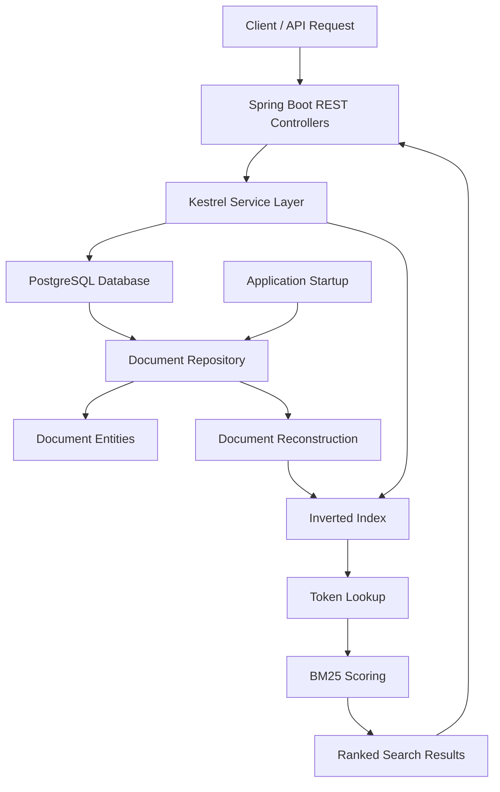

# Kestrel — Custom Search Engine

**A search engine built from scratch in Java, featuring custom inverted indexing, positional indexing, phrase search, and BM25-based relevance ranking.**

[](https://www.oracle.com/java/)
[](https://spring.io/projects/spring-boot)
[](https://www.postgresql.org/)
[](https://maven.apache.org/)
[]()

---

## Overview

Kestrel is a custom-built information retrieval system designed to explore the internal workings of modern search engines.

Rather than relying on existing search frameworks or libraries such as Apache Lucene, Kestrel implements its core indexing and ranking functionality independently. It uses an inverted index to organize documents, positional information to support phrase queries, and BM25-based scoring to rank search results by relevance.

The backend is built with Java and Spring Boot, while PostgreSQL provides persistent document storage. The search index is reconstructed from persisted documents whenever the application starts.

The current implementation includes read/write locking, Docker containerization, and GitHub Actions checks. A React frontend lives in `client/`, separate from the Maven backend.

## Frontend

The Kestrel interface includes real API search, cold-start and retry states, an interactive architecture walkthrough, local benchmark charts, and source-verified documentation. Run it with Node.js 22.12+:

```powershell
cd client
npm ci
Copy-Item .env.example .env.local
npm run dev
```

See [client/README.md](client/README.md) for configuration, validation commands, and exact Vercel deployment steps. Local development uses a GET-only Vite proxy and can hydrate real ranked IDs through document reads when the detailed-search endpoint is unavailable. Static production hosting still requires exact-origin backend CORS. No frontend deployment has been performed.

## Key Features

### Search Engine Core

- **Custom Inverted Index:** Maps individual terms to the documents containing them.
- **Positional Indexing:** Stores term positions within documents to support positional queries.
- **Text Tokenization:** Processes text using case normalization and alphanumeric token extraction.
- **Phrase Search:** Supports searching for consecutive terms using positional information.
- **Term Frequency:** Tracks the frequency of terms within individual documents.
- **Document Frequency:** Tracks the number of documents containing a particular term.
- **BM25 Ranking:** Implements a probabilistic relevance-ranking algorithm using term frequency, inverse document frequency, and document-length normalization.
- **Ranked Retrieval:** Returns documents ordered by their calculated relevance scores.

### Backend and Persistence

- RESTful APIs developed using Spring Boot.
- Document creation, updating, and deletion.
- PostgreSQL integration through Spring Data JPA and Hibernate.
- Database schema versioning and migrations using Flyway.
- Automatic reconstruction of the in-memory search index during application startup.
- Separation of domain models, persistence entities, repositories, services, and controllers.

### Testing

- Unit testing with JUnit 5.
- Tests covering indexing, tokenization, phrase search, ranking, and document operations.
- Validation of document ingestion and persistence.
- Verification of index reconstruction after application restarts.

---

## System Architecture

Kestrel separates persistent document storage from its in-memory search infrastructure.



### Architectural Components

| Component          | Responsibility                                                 |
| ------------------ | -------------------------------------------------------------- |
| Document           | Represents the core document model                             |
| InvertedIndex      | Maintains term-to-document mappings and positional information |
| TextNormalizer     | Tokenizes text, applies stopword policy, and stems terms      |
| BM25 Scoring       | Calculates document relevance scores                           |
| KestrelService     | Coordinates search, ingestion, and document operations         |
| SearchController   | Exposes REST API endpoints                                     |
| DocumentRepository | Handles database operations                                    |
| DocumentEntity     | Maps documents to PostgreSQL records                           |
| Flyway             | Manages database schema migrations                             |
| IndexInitializer   | Reconstructs the search index during application startup       |

### Data Flow

**1. Document Ingestion**

A client submits a document through the REST API. The service persists the document in PostgreSQL and adds it to the in-memory inverted index.

**2. Search Processing**

A search query is normalized (tokenized, stemmed, and filtered for stopwords). The inverted index retrieves relevant document postings, and BM25 scoring calculates their relevance.

**3. Ranked Retrieval**

Documents are sorted by relevance score and returned through the search API.

**4. Index Recovery**

When Kestrel starts, the application loads persisted documents from PostgreSQL and reconstructs the in-memory index. This allows previously stored documents to remain searchable after application restarts.

---

## Technology Stack

| Category             | Technologies                           |
| -------------------- | -------------------------------------- |
| Programming Language | Java 21                                |
| Backend Framework    | Spring Boot                            |
| API Development      | Spring Web MVC, REST APIs              |
| Database             | PostgreSQL                             |
| ORM                  | Spring Data JPA, Hibernate             |
| Database Migrations  | Flyway                                 |
| Build Tool           | Apache Maven                           |
| Testing              | JUnit 5, Spring Boot Test              |
| Frontend             | React, JavaScript, Vite, Tailwind CSS, Motion |

### Engineering Concepts

- Data Structures and Algorithms
- Inverted Indexing
- Information Retrieval
- Positional Indexing
- BM25 Relevance Ranking
- RESTful API Design
- Object-Relational Mapping
- Database Transactions
- Index Reconstruction
- Unit and Integration Testing

---

## API Reference

The backend currently exposes the following endpoints.

| Method | Endpoint                       | Description                    |
| ------ | ------------------------------ | ------------------------------ |
| POST   | `/api/documents`               | Add a new document             |
| PUT    | `/api/documents/{id}`          | Update an existing document    |
| DELETE | `/api/documents/{id}`          | Delete a document              |
| GET    | `/api/search/ranked?q={query}` | Retrieve ranked search results |
| GET    | `/api/documents`               | List persisted documents       |

### 1. Add a Document

**POST** `/api/documents`

Request:

```json
{
  "id": "doc-001",
  "title": "Java Programming",
  "content": "Java is a powerful programming language.",
  "url": "https://example.com/java"
}
```

Expected response: `201 Created`

### 2. Update a Document

**PUT** `/api/documents/doc-001`

Request:

```json
{
  "id": "doc-001",
  "title": "Python Programming",
  "content": "Python is widely used in machine learning.",
  "url": "https://example.com/python"
}
```

Expected response: `200 OK` with the updated document response

### 3. Delete a Document

**DELETE** `/api/documents/doc-001`

Expected response: `200 OK` with the delete response

### 4. Ranked Search

**GET** `/api/search/ranked?q=Python`

Returns a list of document identifiers ordered by relevance.

**GET** `/api/documents` lists persisted documents.

---

## Getting Started

### Prerequisites

Ensure the following are installed:

- Java Development Kit 21
- Apache Maven
- PostgreSQL database or a Supabase PostgreSQL instance
- Git

### 1. Clone the Repository

```bash
git clone <YOUR_REPOSITORY_URL>
cd Kestrel
```

### 2. Configure Environment Variables

Create a `.env` file in the project root directory.

```dotenv
DB_URL=jdbc:postgresql://YOUR_HOST:5432/postgres?sslmode=require
DB_USERNAME=YOUR_DATABASE_USERNAME
DB_PASSWORD=YOUR_DATABASE_PASSWORD
```

**Important:** Never commit your `.env` file or database credentials to version control.

### 3. Run the Application

```bash
mvn -DskipTests package
```

This builds the application without running the integration suite. Start Spring Boot with:

```bash
mvn spring-boot:run
```

The backend will be available at:

```text
http://localhost:8080
```

Flyway automatically applies pending database migrations during startup. Hibernate validates the database schema, and the application reconstructs the search index from persisted documents.

### 4. Run Tests

Run regular tests without the PostgreSQL integration test:

```bash
mvn "-Dtest=*,!KestrelIntegrationTest" test
```

Integration tests use a dedicated local PostgreSQL database (not your Supabase database). Set up `kestrel_test` and a restricted `kestrel_test` user, then create `src/test/resources/application-test.properties` if it is not already present in your checkout. Use test-only credentials (`KESTREL_TEST_DB_PASSWORD`), a local datasource URL, and `@ActiveProfiles("test")` on the integration test class. Verify the effective datasource and Flyway URLs point to `127.0.0.1` **before** running the integration tests:

```powershell
mvn "-Dtest=KestrelIntegrationTest" test
```

Never run integration tests against a shared or production database. The test setup is local to your working copy and may not yet be included in the public repository.

---

## Database Design

Kestrel currently uses PostgreSQL to persist document information.

### Documents Table

| Column  | Data Type     | Description                |
| ------- | ------------- | -------------------------- |
| id      | VARCHAR(255)  | Unique document identifier |
| title   | VARCHAR(255)  | Document title             |
| content | TEXT          | Document content           |
| url     | VARCHAR(2048) | Document URL               |

Database schema changes are version-controlled through Flyway migrations.

Migration files are maintained under:

```text
src/main/resources/db/migration/
```

---

## Retrieval Quality — BEIR Benchmarks

Kestrel was evaluated with an **unchanged production ranking configuration** across four independently indexed datasets from [BEIR](https://github.com/beir-cellar/beir). Each run used the official `test` relevance judgments and the corpus/query files for that dataset. The BM25 implementation uses separate title and body fields, with `k1 = 1.5`, `b = 0.75`, and a title weight of `2.0`.

| Dataset | Documents | Evaluated queries | Precision@10 | Recall@10 | NDCG@10 |
| --- | ---: | ---: | ---: | ---: | ---: |
| SciDocs | 25,657 | 1,000 | 0.0829 | 0.1681 | **0.1614** |
| SciFact | 5,183 | 300 | 0.0843 | 0.7637 | **0.6291** |
| NFCorpus | 3,633 | 323 | 0.2279 | 0.1538 | **0.3186** |
| FiQA-2018 | 57,638 | 648 | 0.0699 | 0.3143 | **0.2528** |

**Evaluation notes:** The four corpora contain **92,111 documents in total**, indexed separately—not in a single 92K-document index. The test splits contain **2,271 evaluated queries** in total. NDCG uses **linear relevance gains** with logarithmic rank discount, matching the standard `trec_eval` convention. Precision and recall count judgments greater than zero as relevant. Dataset scores should be compared with baselines **on the same dataset**, not against one another as measures of absolute search quality. Published BM25 scores are useful context, but exact comparisons require matching indexing, preprocessing, and evaluator settings.

The BEIR data files are not part of this repository. Place the downloaded datasets under `datasets/<dataset-name>/` with `corpus.jsonl`, `queries.jsonl`, and `qrels/test.tsv`, then run the corresponding dataset-evaluation tests if available in your checkout.

## In-Memory Performance Benchmark

A separate local performance run measured the **production BM25** implementation over a 25K-document SciDocs corpus prefix.

| Measurement | 25K-document result |
| --- | ---: |
| Median indexing throughput | 3,874 documents/second |
| Median search latency | 14.239 ms |
| P95 search latency | 36.235 ms |
| P99 search latency | 47.699 ms |
| Single-thread search throughput | 64 queries/second |
| Estimated incremental retained heap | 343.44 MiB |

A full 25,657-document corpus build took **6.140 seconds** in the recorded run. These are **in-memory, single-thread measurements**. They exclude HTTP, service, and database latency. Heap is an estimate of retained Java heap, not process memory usage (RSS). Timing results are machine-, JVM-, workload-, and methodology-dependent, and are not production SLAs. The benchmark is opt-in and can be run with:

```powershell
mvn "-Dtest=PerformanceBenchmarkTest" "-Dkestrel.performanceBenchmark=true" test
```

This command requires the benchmark dataset locally and may generate reports in the project root. Keep raw benchmark outputs and local-only reports out of Git.

---

## Development Roadmap

Kestrel is evolving from a custom search engine into a more reliable, concurrent, containerized backend service.

### Completed

- [x] Custom inverted index implementation
- [x] Text tokenization and normalization
- [x] Positional indexing
- [x] Phrase search
- [x] Term and document frequency calculations
- [x] BM25-based relevance scoring
- [x] Ranked document retrieval
- [x] Spring Boot REST API
- [x] PostgreSQL integration
- [x] Spring Data JPA integration
- [x] Flyway database migrations
- [x] Document creation, updating, and deletion
- [x] Automatic index reconstruction on startup
- [x] Local PostgreSQL integration tests (in the current development environment)

### Current infrastructure

- [x] Concurrent index reads and exclusive writes through ReentrantReadWriteLock
- [x] Docker and Docker Compose packaging
- [x] GitHub Actions unit and PostgreSQL integration checks
- [x] React frontend prepared for Vercel
- [ ] Deploy current detailed-search API and exact-origin CORS configuration to Render
- [ ] Host the frontend on Vercel when ready

---

## Design Principles

Kestrel is being developed around a few core engineering principles:

**1. Build from First Principles**

Implement the core search algorithms independently to understand and control the underlying indexing and retrieval mechanisms.

**2. Separation of Concerns**

Keep search logic, persistence, API handling, and application configuration independently structured.

**3. Persistent Storage, Rebuildable Index**

Treat PostgreSQL as the source of truth and the in-memory inverted index as a reconstructable search structure.

**4. Testable Engineering**

Validate individual algorithms and application behavior through automated tests and measurable benchmarks.

**5. Incremental Scalability**

Introduce concurrency, containerization, and deployment as the architecture evolves.

---

## Project Status

Kestrel's core engine, persistence, multi-dataset evaluation, concurrency controls, Docker configuration, CI checks, and frontend are implemented. The backend is hosted on Render; the current detailed-results endpoint and CORS configuration still need deployment. The frontend has not been hosted yet.

**The goal is to build a search platform while maintaining control over its core indexing and retrieval algorithms.**

---

## Author

**Chetan Seth**

Information Technology Graduate | Software Engineering | Java | Backend Development | Search Systems

[GitHub](https://github.com/Cs7797) · [LinkedIn](https://www.linkedin.com/in/chetan-seth-b3b266302/)

---

_Built from scratch with Java. Designed to understand search, not just use it._
