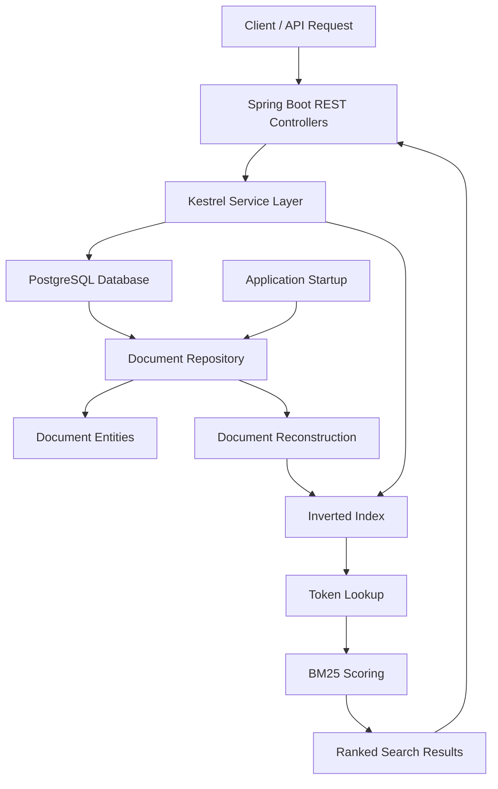

# Kestrel — Custom Search Engine

**A search engine built from scratch in Java, featuring custom inverted indexing, positional indexing, phrase search, and BM25-based relevance ranking.**

[](https://www.oracle.com/java/)
[](https://spring.io/projects/spring-boot)
[](https://www.postgresql.org/)
[](https://maven.apache.org/)
[]()

---

## Overview

Kestrel is a custom-built information retrieval system designed to explore the internal workings of modern search engines.

Rather than relying on existing search frameworks or libraries such as Apache Lucene, Kestrel implements its core search functionality independently. It uses an inverted index to organize documents, positional information to support phrase queries, and BM25-based scoring to rank search results by relevance.

The backend is built with Java and Spring Boot, while PostgreSQL provides persistent document storage. The search index is reconstructed from persisted documents whenever the application starts.

The project is being extended into a full-stack search platform, with a React-based interface, concurrent indexing and retrieval, performance optimization, containerization, and deployment planned as part of its development roadmap.

## Key Features

### Search Engine Core

- **Custom Inverted Index:** Maps individual terms to the documents containing them.
- **Positional Indexing:** Stores term positions within documents to support positional queries.
- **Text Tokenization:** Processes text using case normalization and alphanumeric token extraction.
- **Phrase Search:** Supports searching for consecutive terms using positional information.
- **Term Frequency:** Tracks the frequency of terms within individual documents.
- **Document Frequency:** Tracks the number of documents containing a particular term.
- **BM25 Ranking:** Implements a probabilistic relevance-ranking algorithm using term frequency, inverse document frequency, and document-length normalization.
- **Ranked Retrieval:** Returns documents ordered by their calculated relevance scores.

### Backend and Persistence

- RESTful APIs developed using Spring Boot.
- Document creation, updating, and deletion.
- PostgreSQL integration through Spring Data JPA and Hibernate.
- Database schema versioning and migrations using Flyway.
- Automatic reconstruction of the in-memory search index during application startup.
- Separation of domain models, persistence entities, repositories, services, and controllers.

### Testing

- Unit testing with JUnit 5.
- Tests covering indexing, tokenization, phrase search, ranking, and document operations.
- Validation of document ingestion and persistence.
- Verification of index reconstruction after application restarts.

---

## System Architecture

Kestrel separates persistent document storage from its in-memory search infrastructure.



### Architectural Components

| Component          | Responsibility                                                 |
| ------------------ | -------------------------------------------------------------- |
| Document           | Represents the core document model                             |
| InvertedIndex      | Maintains term-to-document mappings and positional information |
| Tokenizer          | Extracts normalized terms from document content                |
| BM25 Scoring       | Calculates document relevance scores                           |
| KestrelService     | Coordinates search, ingestion, and document operations         |
| SearchController   | Exposes REST API endpoints                                     |
| DocumentRepository | Handles database operations                                    |
| DocumentEntity     | Maps documents to PostgreSQL records                           |
| Flyway             | Manages database schema migrations                             |
| IndexInitializer   | Reconstructs the search index during application startup       |

### Data Flow

**1. Document Ingestion**

A client submits a document through the REST API. The service persists the document in PostgreSQL and adds it to the in-memory inverted index.

**2. Search Processing**

A search query is tokenized. The inverted index retrieves relevant document postings, and BM25 scoring calculates their relevance.

**3. Ranked Retrieval**

Documents are sorted by relevance score and returned through the search API.

**4. Index Recovery**

When Kestrel starts, the application loads persisted documents from PostgreSQL and reconstructs the in-memory index. This allows previously stored documents to remain searchable after application restarts.

---

## Technology Stack

| Category             | Technologies                           |
| -------------------- | -------------------------------------- |
| Programming Language | Java 21                                |
| Backend Framework    | Spring Boot                            |
| API Development      | Spring Web MVC, REST APIs              |
| Database             | PostgreSQL                             |
| ORM                  | Spring Data JPA, Hibernate             |
| Database Migrations  | Flyway                                 |
| Build Tool           | Apache Maven                           |
| Testing              | JUnit 5, Spring Boot Test              |
| Frontend             | React.js, Vite, Tailwind CSS — planned |

### Engineering Concepts

- Data Structures and Algorithms
- Inverted Indexing
- Information Retrieval
- Positional Indexing
- BM25 Relevance Ranking
- RESTful API Design
- Object-Relational Mapping
- Database Transactions
- Index Reconstruction
- Unit and Integration Testing

---

## API Reference

The backend currently exposes the following endpoints.

| Method | Endpoint                       | Description                    |
| ------ | ------------------------------ | ------------------------------ |
| POST   | `/api/documents`               | Add a new document             |
| PUT    | `/api/documents/{id}`          | Update an existing document    |
| DELETE | `/api/documents/{id}`          | Delete a document              |
| GET    | `/api/search/ranked?q={query}` | Retrieve ranked search results |

### 1. Add a Document

**POST** `/api/documents`

Request:

```json
{
  "id": "doc-001",
  "title": "Java Programming",
  "content": "Java is a powerful programming language.",
  "url": "https://example.com/java"
}
```

Expected response: `201 Created`

### 2. Update a Document

**PUT** `/api/documents/doc-001`

Request:

```json
{
  "id": "doc-001",
  "title": "Python Programming",
  "content": "Python is widely used in machine learning.",
  "url": "https://example.com/python"
}
```

Expected response: `204 No Content`

### 3. Delete a Document

**DELETE** `/api/documents/doc-001`

Expected response: `204 No Content`

### 4. Ranked Search

**GET** `/api/search/ranked?q=Python`

Returns a list of document identifiers ordered by relevance.

---

## Getting Started

### Prerequisites

Ensure the following are installed:

- Java Development Kit 21
- Apache Maven
- PostgreSQL database or a Supabase PostgreSQL instance
- Git

### 1. Clone the Repository

```bash
git clone YOUR_GITHUB_REPOSITORY_URL
cd Kestrel
```

### 2. Configure Environment Variables

Create a `.env` file in the project root directory.

```dotenv
DB_URL=jdbc:postgresql://YOUR_HOST:5432/postgres?sslmode=require
DB_USERNAME=YOUR_DATABASE_USERNAME
DB_PASSWORD=YOUR_DATABASE_PASSWORD
```

**Important:** Never commit your `.env` file or database credentials to version control.

### 3. Run the Application

```bash
mvn clean install
```

Start the Spring Boot application:

```bash
mvn spring-boot:run
```

The backend will be available at:

```text
http://localhost:8080
```

Flyway automatically applies pending database migrations during startup. Hibernate validates the database schema, and the application reconstructs the search index from persisted documents.

### 4. Run Tests

Execute the test suite:

```bash
mvn clean test
```

---

## Database Design

Kestrel currently uses PostgreSQL to persist document information.

### Documents Table

| Column  | Data Type     | Description                |
| ------- | ------------- | -------------------------- |
| id      | VARCHAR(255)  | Unique document identifier |
| title   | VARCHAR(255)  | Document title             |
| content | TEXT          | Document content           |
| url     | VARCHAR(2048) | Document URL               |

Database schema changes are version-controlled through Flyway migrations.

Migration files are maintained under:

```text
src/main/resources/db/migration/
```

---

## Performance and Benchmarking

Kestrel includes an initial benchmark for evaluating indexing and ranked-search performance.

The preliminary benchmark used a dataset of 10,000 documents and measured indexing time and ranked-search latency.

| Metric                       | Preliminary Result |
| ---------------------------- | -----------------: |
| Documents indexed            |             10,000 |
| Indexing time                |           64.33 ms |
| Median ranked-search latency |            0.50 ms |

**Benchmark context:** These are preliminary local measurements, not production performance guarantees. Results depend on hardware, dataset characteristics, JVM behavior, and benchmark methodology. Further benchmarking and optimization are planned.

---

## Development Roadmap

Kestrel is actively evolving from a custom search engine into a full-stack search platform.

### Completed

- [x] Custom inverted index implementation
- [x] Text tokenization and normalization
- [x] Positional indexing
- [x] Phrase search
- [x] Term and document frequency calculations
- [x] BM25-based relevance scoring
- [x] Ranked document retrieval
- [x] Spring Boot REST API
- [x] PostgreSQL integration
- [x] Spring Data JPA integration
- [x] Flyway database migrations
- [x] Document creation, updating, and deletion
- [x] Automatic index reconstruction on startup

### In Progress

- [ ] Comprehensive integration testing
- [ ] React-based search interface
- [ ] Document management dashboard
- [ ] Search analytics and performance visualization
- [ ] Concurrent indexing and retrieval
- [ ] Thread-safety improvements
- [ ] Performance optimization

### Planned

- [ ] Docker-based containerization
- [ ] CI/CD pipeline integration
- [ ] Cloud deployment
- [ ] Production-oriented monitoring
- [ ] Advanced search capabilities and scalability improvements

---

## Design Principles

Kestrel is being developed around a few core engineering principles:

**1. Build from First Principles**

Implement the core search algorithms independently to understand and control the underlying indexing and retrieval mechanisms.

**2. Separation of Concerns**

Keep search logic, persistence, API handling, and application configuration independently structured.

**3. Persistent Storage, Rebuildable Index**

Treat PostgreSQL as the source of truth and the in-memory inverted index as a reconstructable search structure.

**4. Testable Engineering**

Validate individual algorithms and application behavior through automated tests and measurable benchmarks.

**5. Incremental Scalability**

Introduce concurrency, containerization, and deployment as the architecture evolves.

---

## Project Status

Kestrel's core search engine and backend persistence layer are implemented. The project is currently being extended with a full-stack interface, improved testing, concurrency, performance optimization, and deployment infrastructure.

**The goal is to build a search platform while maintaining control over its core indexing and retrieval algorithms.**

---

## Author

**Chetan Seth**

Information Technology Graduate | Software Engineering | Java | Backend Development | Search Systems

[GitHub](www.github.com/Cs7797) · [LinkedIn](https://www.linkedin.com/in/chetan-seth-b3b266302/)

---

_Built from scratch with Java. Designed to understand search, not just use it._
